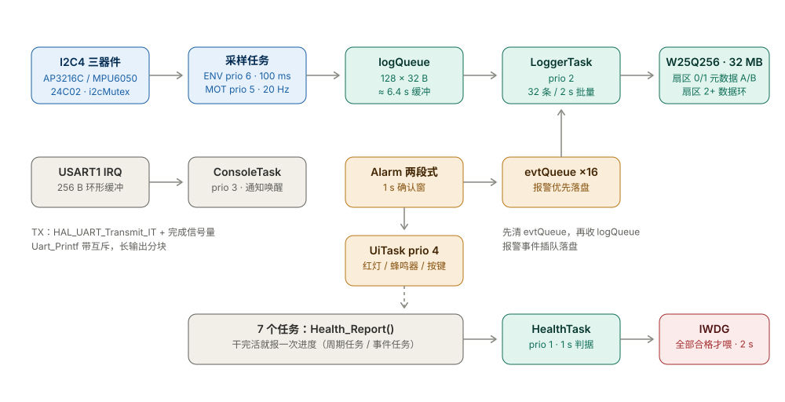

# H743 Sentinel

基于 **STM32H743XI（Cortex-M7）** 的多任务环境与姿态监测记录仪：在 CubeMX 生成的 HAL 工程上**手动移植 FreeRTOS V9.0.0**，把裸机轮询控制台改造为事件驱动任务，三路 I2C 传感器共享总线并发采样，数据以定长快照写入 QSPI Flash。

> **当前进度**：Step 0–8 代码全部完成并通过 AC5 编译（0 Error / 0 Warning）；
> Step 5、Step 6 的采样与日志链路已上板验证；
> Step 6 的断电 ×3 / 跨页写 / 环形覆盖，Step 7 的两段式报警指标，Step 8 的 IWDG 与长跑
> **仍需在板子上逐项回填数据**（清单见 [docs/04-验收清单.md](docs/04-验收清单.md)）。
> 本仓库只包含已完成并验证过的部分，未完成的设计在 [路线图](#路线图) 中列出。

---

## 亮点

- **手动移植，不是套模板**：内核文件、`FreeRTOSConfig.h`、`SysTick` 接管、HAL 时基重分配全部手改并逐项验证，提交历史按 Step 拆分（`git log --oneline` 可看到完整施工顺序）
- **时基冲突处理**：SysTick 交给内核后，HAL 时基迁至 TIM7（TIM6 已被呼吸灯占用），并删掉 `SysTick_Handler` 里残留的 `HAL_IncTick()`，避免 tick 被"双喂"
- **中断优先级一致性**：NVIC 4 位分组，`configLIBRARY_MAX_SYSCALL_INTERRUPT_PRIORITY = 5`，所有调用 `...FromISR()` 的中断统一为 5
- **控制台事件化**：RX 改中断 + 256 B 环形缓冲 + 任务通知；TX 改 `HAL_UART_Transmit_IT` + 完成信号量 + 带互斥的 `Uart_Printf`，长输出分块、锁不跨输出
- **共享总线**：EEPROM / AP3216C / MPU6050 三器件挂在同一条 I2C4 上，用互斥量保护并统一句柄
- **报警与看门狗**：两段式确认（1 s 窗）后才声光动作，事件快照优先落盘；7 个任务全部"报活"才喂 IWDG
- **自研代码约 5.4k 行**（`App/` + `BSP/` + `User/`，不含 HAL 与 FreeRTOS 内核）

---

## 硬件

| 器件 | 型号 | 接口 / 地址 |
|---|---|---|
| MCU | STM32H743XIH6（Cortex-M7，480 MHz） | — |
| 光照 + 接近 | AP3216C | I2C4，0x1E |
| 六轴 IMU | MPU6050 | I2C4，0x68 |
| EEPROM | 24C02（8 B 配置页） | I2C4，0x50 |
| 外部 Flash | W25Q256（32 MB） | QSPI |
| 板载 | 3 路 PWM 呼吸灯（PB0/PB1/PA3）、TIM6 10 ms 中断、RTC + VBAT | — |

---

## 软件架构



```
USART1 IRQ ──► 256B ring ──► task notify ──► ConsoleTask (prio 3)
                                                │  Uart_Printf (uartMutex + txDoneSem)
I2C4 (共享总线, i2cMutex)
   ├─ AP3216C ─┐
   ├─ MPU6050 ─┼─► EnvTask (prio 6, 100 ms)  ─┐
   └─ EEPROM   │   MotionTask (prio 5, 50 ms) ─┴─► logQueue (128 × 32 B)
                                                │        │
                    Alarm (1 s 确认窗) ─► evtQueue (16)  │
                                                └────────┴─► LoggerTask (prio 2, 32 条/2 s)
                                                                   │
                                                             QSPI W25Q256
                                                       扇区0/1 元数据 A/B · 扇区2+ 数据环

每个任务 → Health_Report() ─► HealthTask (prio 1, 1 s) ─► 全部合格才 HAL_IWDG_Refresh()
```

### 任务表（当前实现）

| 任务 | 优先级 | 栈（word） | 周期 | 职责 |
|---|---|---|---|---|
| `ENV` | 6 | 160 | 100 ms | 读光照 / 接近，更新环境缓存并喂两段式光照判定 |
| `MOT` | 5 | 160 | 50 ms（可配 20–200） | 读加速度，合成 20 Hz 快照入队，喂运动判定 |
| `UI` | 4 | 384 | 50 ms / 事件 | 灯效（呼吸 / 红快闪 / 蓝闪）、蜂鸣器 200/300 ms、按键消抖 |
| `CON` | 3 | 512 | 事件驱动 | 命令行解析、回显、行编辑（任务通知唤醒，1 s 心跳） |
| `LOG` | 2 | 320 | 事件驱动 | 先清 evtQueue 再收 logQueue，攒 32 条或 2 s 写盘，提交检查点 |
| `LED` | 2 | 128 | 500 ms | 心跳灯（`vTaskDelayUntil`） |
| `MON` | 2 | 256 | 3 s | 打印 tick/HAL tick 增量、heap、`vTaskList` |
| `HLTH` | 1 | 256 | 1 s | 汇总 7 个任务的进度判据，全部合格才刷新 IWDG（2 s） |
| `Tmr Svc` | 2 | 512 | — | 软件定时器服务：报警 30 s 自动静音 |

> 栈水位可直接看 `MON` 任务每 3 s 打印的 `vTaskList`（Stack 列即高水位，单位 word）；
> 30 min 采样丢点统计用 `status` 的 `drop=` 回填（见[路线图](#路线图)）。

### 日志层（Step 6）

| 项 | 值 |
|---|---|
| 记录 | 32 B 定长：`seq(4) + 时间戳(4) + als(2) + ps(2) + acc(6) + flags(2) + 保留(10) + CRC16(2)` |
| Flash 布局 | 扇区 0 / 1 = 元数据检查点副本 A / B（64 B × 64 槽）；扇区 2 起 = 数据环 |
| 批量策略 | 攒满 32 条或超时 2 s 写一批；每 256 条或 30 s 提交一次检查点 |
| 掉电安全 | 先写数据、后提交检查点；A/B 轮换时**当前副本存在有效检查点才允许擦另一份**，新检查点读回校验成功才推进偏移 |
| 启动恢复 | 取最新有效检查点 → 向前扫描"CRC 有效且 seq 连续"的记录，补齐未提交部分 |
| 写入约束 | 按 256 B 页边界切片（不跨页）、不跨擦除扇区；写后读回校验 |
| 保留时长 | 32 MB ≈ **14.5 h** 滚动窗口 @20 Hz（降低快照频率可线性延长） |

### 报警与 UI（Step 7）

| 项 | 设计 |
|---|---|
| 光照报警 | ALS < `thr_light` 连续 10 个 100 ms 采样（1 s 确认窗）；中途变亮或读取失败即清零 |
| 运动报警 | 相邻加速度差值平方 > `thr_motion²`，泄漏计数累计到 `1000 ms ÷ 采样周期`（默认 20 个样本 ≈1 s） |
| 坏样本处理 | 读取失败的样本不参与判定：光照计数清零、运动基线作废（避免 I2C 错误被当成"变暗/晃动"） |
| 事件通道 | 触发 → 置 `EVT_ALARM_*` → UiTask 50 ms 内切换灯效；事件快照进 `evtQueue(16)`，LoggerTask 优先落盘，flags = `0x0010/0x0020/0x0040` |
| 声光 | 红灯 100 ms 亮 / 100 ms 灭；蜂鸣器 PI8 200 ms 响 / 300 ms 停，触发瞬间从"响"开始 |
| 延迟指标 | UiTask 记录"确认 → 声光动作"毫秒数，`alarm` 命令回读 `last confirm->action` |
| 自动静音 | 触发后启动 30 s 单次软件定时器，只停蜂鸣器；红灯持续到 `alarm clear` / KEY2 |
| 按键 | PA0(KEY1) 静音切换、PC13(KEY2) 清除报警；EXTI 下降沿（优先级 5）→ 任务通知 → 20 ms 消抖 |

### 健康监控与 IWDG（Step 8）

| 项 | 设计 |
|---|---|
| 判据 | 每个任务在"干完活"时调用 `Health_Report()`；HealthTask 检查各自允许的最大沉默时间 |
| 窗口 | ENV 400 / MOT 500 / UI 400 / CON 2500 / LOG 6000 / LED 2500 / MON 5000 ms |
| 喂狗 | 7 项全部合格才 `HAL_IWDG_Refresh()`；任一超时立即停喂 |
| IWDG | LSI≈32 kHz，64 分频 → 500 Hz，重装 1000 → **超时 2 s**；由 `Health_Start()` 在调度器启动前启用 |
| 演示 | `wd test <s>` 停喂，约 2 s 后复位；`status` 打印保存下来的复位原因（POR/BOR/PIN/SFT/IWDG/WWDG/LPWR） |
| 注意 | 调试器暂停超过 2 s 会触发 IWDG 复位，属预期行为 |

### 缓冲区与参数

| 参数 | 值 | 说明 |
|---|---|---|
| `SAMPLE_QUEUE_LEN` | 128 | logQueue 深度，20 Hz 下约 6.4 s 缓冲 |
| 快照大小 | 32 B | `seq(4) + 时间戳(4) + als(2) + ps(2) + ax/ay/az(6) + flags(2) + 保留 + CRC16(2)` |
| `configTOTAL_HEAP_SIZE` | 48 KB | `heap_4` |
| `configMAX_PRIORITIES` | 32 | 应用最高优先级 6 |
| `configCHECK_FOR_STACK_OVERFLOW` | 2 | 调试期开启 |
| 时间戳 | RTC 日历 / 上电 tick | 无有效 RTC 时退化为 boot tick，`flags` bit15 = 0 标识 |

### 资源占用（AC5 V5.06u7 实编译）

| 项 | 大小 |
|---|---|
| Code + RO-data | 55,340 + 2,168 = **57,508 B（≈56.2 KB）** |
| RW-data + ZI-data | 308 + 53,636 = **53,944 B（≈52.7 KB）**，其中 48 KB 是 FreeRTOS heap |
| 编译结果 | **0 Error(s), 0 Warning(s)**（AC5 V5.06u7，全量编译 + 链接复核） |

---

## 串口命令

波特率 115200-8-N-1，行编辑支持退格与超长丢弃，命令大小写不敏感。

| 命令 | 作用 |
|---|---|
| `help` | 命令列表 |
| `info` | 版本、配置、log 计数 |
| `live <n>` | 打印 n 条实时快照（时间戳 / 光照 / 接近 / 加速度 / 新鲜度） |
| `sensor` | 传感器状态与原始值 |
| `i2c scan` | 扫描 0x08–0x77，应看到 0x1E / 0x50 / 0x68 |
| `time` / `time set YYYY-MM-DD hh:mm:ss` | RTC 读取 / 设置（LSE，掉电由 VBAT 保持） |
| `dump <n\|all>` / `erase` | 日志导出（32 B 快照）/ 逻辑擦除 |
| `color` / `pwm` / `save` / `load` | 灯效与配置（存 EEPROM） |
| `alarm [clear\|mute\|unmute]` | 查看报警状态与"确认→声光"延迟 / 清除 / 静音 |
| `cfg [show\|save\|load\|reset\|thr <light> <motion>\|rate <ms>]` | 阈值、采样周期、配置持久化 |
| `status` | 健康、复位原因、报警、日志、RTC 一屏 |
| `wd test <1..60>` | 停止喂狗 s 秒（约 2 s 后 IWDG 复位，用于验收） |
| `logpause on\|off` | 暂停/恢复日志消费（灌满队列，验证 evtQueue 优先级） |
| `qtest` | QSPI 32 MB 边界读写测试（0x00F00000 / 0x01800000 附近） |

---

## 快速开始

1. **工具链**：Keil MDK 5 + **ARM Compiler 5（V5.06u7）** + MicroLIB；已安装 `Keil.STM32H7xx_DFP`
   > FreeRTOS V9.0.0 的 `port/RVDS/ARM_CM7` 是 armcc 语法，**不要切到 AC6**（切了编不过）。
2. 打开 `MDK-ARM/demo2_1.uvprojx` → Rebuild → 下载
3. 串口 115200 连接，输入 `help`
4. `i2c scan` 确认三个器件在位，`live 5` 看实时数据，`time set 2026-10-18 10:00:00` 校时

> 仓库不含 Keil 的 `Objects/`、`Listings/` 与 `.uvoptx`，clone 后首次打开需重新选择调试器（ST-Link / J-Link）。

---

## 目录结构

```
App/        应用层：console（命令行）、sample（采样）、log（日志）、Config（EEPROM）
App/system/ 事件组、两段式报警、UI（灯/蜂鸣器/按键）、健康监控 + IWDG
BSP/        板级驱动：uart、i2c（总线互斥）、sensor（AP3216C/MPU6050）、flash（QSPI）、ee、rtc、led、pwm
Core/       CubeMX 生成的 HAL 初始化与中断向量（stm32h7xx_it.c 中 SysTick 已交给内核）
FreeRTOS/   内核 V9.0.0：src / include / port(RVDS ARM_CM7) / heap_4
User/       FreeRTOSConfig.h
docs/       移植施工指南、任务设计、日志格式、验收清单
images/     架构图
LICENSES/   第三方许可证全文
```

---

## 设计取舍与踩坑记录

| 问题 | 现象 | 处理 |
|---|---|---|
| HAL 时基与内核抢 SysTick | 接上 FreeRTOS 后 `HAL_GetTick()` 与实际时间不符 | 时基改 TIM7；`SysTick_Handler` 只调 `xPortSysTickHandler()`，删掉 `HAL_IncTick()` |
| CubeMX 重复回调 | `L6200E: HAL_TIM_PeriodElapsedCallback multiply defined` | 删 `main.c` 版，TIM7/TIM6 合并到 `bsp_led.c` 一个回调两分支 |
| CMSIS 汇编报错 | `A1586E: Bad operand type`（`__NVIC_PRIO_BITS` = `4U`） | `configPRIO_BITS` 写死 4，不改内核 `port.c` |
| BASEPRI 泄漏 | TIM6/TIM7 中断被长期屏蔽，`uxCriticalNesting` 哨兵值掩盖了问题 | 调度器启动前的 I2C 操作跳过互斥量；RTOS 对象创建后显式清 BASEPRI |
| 三器件共享 I2C | 传感器读取与 EEPROM 保存并发时偶发 NACK | 统一 I2C4 句柄 + `i2cMutex`（带 100 ms 超时），所有访问走锁封装 |
| QSPI 4 字节地址模式 | 32 MB 容量下线性读超过 16 MB 边界失效 | 初始化时进入 4-byte address mode |
| 阻塞式 `printf` 拖慢任务 | 长输出时其他任务被饿死 | TX 改中断 + 完成信号量；`dump` 分块输出，锁不跨输出 |
| 传感器失败误报警 | 读取失败时变量保持 0，被判定成"变暗/晃动" | `Alarm_Feed*` 增加 `valid` 参数：坏样本不参与判定、基线作废 |

---

## 已知限制

- Step 6 的**断电 ×3、跨页写、环形覆盖**与 Step 7/8 的**两段式指标、IWDG 复位、≥2 h 长跑**实测数据尚未回填（见 [docs/04-验收清单.md](docs/04-验收清单.md)）
- IWDG 已启用（2 s），**调试器暂停超过 2 s 会复位**，属预期行为；做断电/长跑测试时不要用断点停住
- 蜂鸣器按 PI8 高电平响实现，若上电常响，把 `ui_task.c` 的 `BUZZER_ACTIVE_HIGH` 改成 0
- 按键按 PA0 / PC13 低电平有效、内部上拉实现；若板子外部已有上下拉，行为不变
- 报警为**锁存**式：触发后红灯持续到 `alarm clear` / KEY2，30 s 只自动静音不停报警
- RTC 未接电池时时间戳退化为上电 tick，`flags` bit15 置 0 区分

---

## 路线图

| Step | 内容 | 状态 |
|---|---|---|
| 0–4 | 时基迁移、内核移植、控制台任务化 | ✅ 完成并上板 |
| 5 | I2C 总线锁、三传感器驱动、20 Hz 采样、RTC | ✅ 完成并上板 |
| 6 | 32 B 快照 + 元数据双副本 + 环形覆盖 + 跨页切片 | 🟡 代码完成，断电/跨页/覆盖验证待补 |
| 7 | 事件组 + evtQueue、两段式报警、UI / 按键 / 配置扩展 | 🟡 代码完成，两段式指标待回填 |
| 8 | HealthTask 健康判据 + IWDG、故障注入、长跑 | 🟡 代码完成，复位/长跑待回填 |
| — | README 截图与实测数据（`v0.2`） | ⏳ 待补 |

---

## 致谢

- FreeRTOS 内核与移植模板来自 [FreeRTOS](https://www.freertos.org/) V9.0.0 与野火 H743 Pro 教学例程（仅作移植参考）
- 传感器寄存器操作参考野火《AP3216C 全功能例程》《MPU6050 基本数据读取》，**代码为本项目重写**（自有 API、总线加锁、错误码）
- HAL / CMSIS 由 STM32CubeMX 生成

## 许可

本项目自研代码（`App/` `BSP/` `User/` `docs/`）采用 **MIT**，见 [LICENSE](LICENSE)。
`FreeRTOS/`、`Drivers/`、`Core/` 等第三方组件按各自许可证分发，详见 [THIRD_PARTY_NOTICES.md](THIRD_PARTY_NOTICES.md)。
